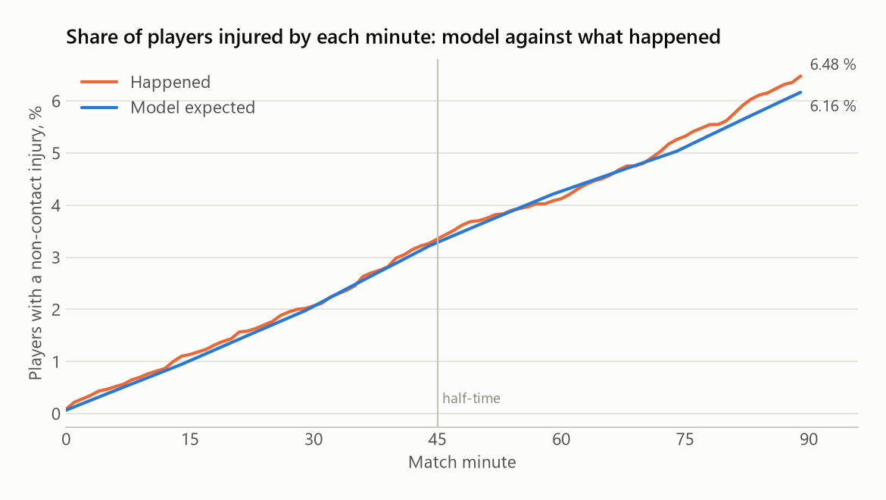
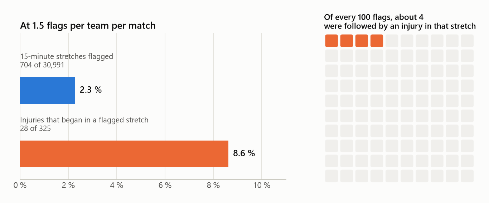
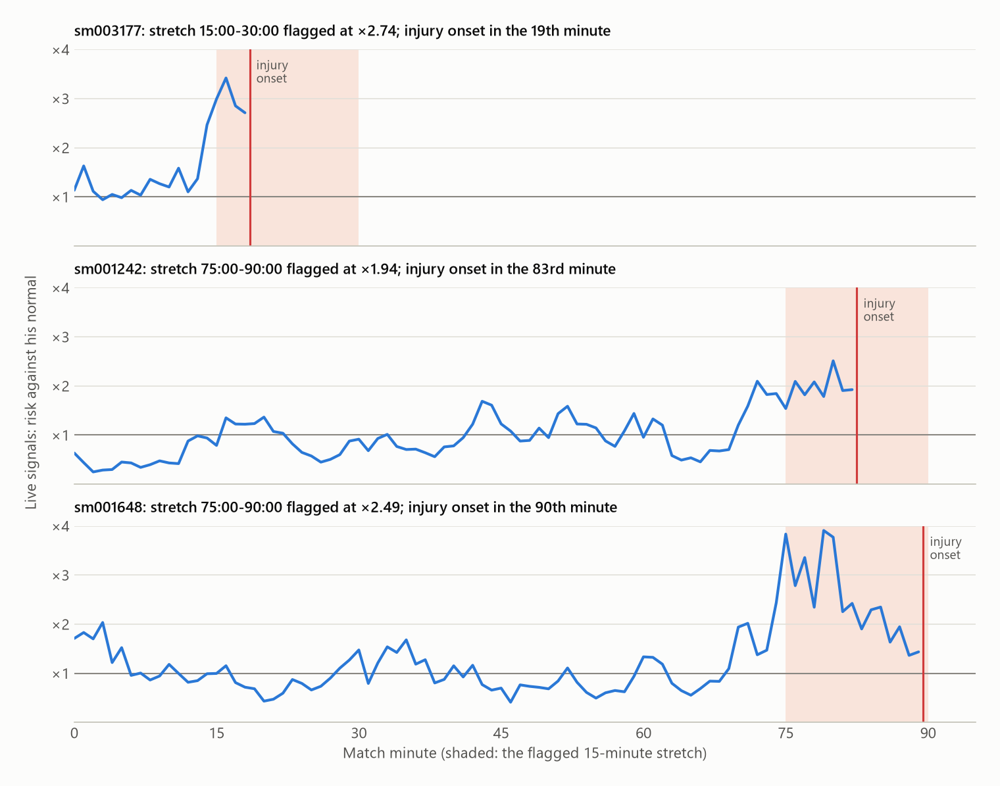

# live-injury-risk

Local, offline-first decision support for football bench staff: each player's injury risk for the
rest of the match, relative to his own normal, with the reason in plain words and the age and
quality of the data behind it.

**Intended purpose.** Research and decision support for qualified staff.

<p align="center">
  
</p>

> **Everything on this page comes from synthetic data.** No real club, player or match data has
> gone through the tool yet. The screens show a synthetic match replayed through the live
> system, and the statistics come from synthetic seasons where we set the truth ourselves. What
> that does and does not show is set out in
> [What has not been tested yet](#what-has-not-been-tested-yet).

## Contents

1. [For coaches and staff: reading the screen](#for-coaches-and-staff-reading-the-screen)
2. [How it works during a match](#how-it-works-during-a-match)
3. [A replayed match, moment by moment](#a-replayed-match-moment-by-moment)
4. [Does the live part add anything?](#does-the-live-part-add-anything)
5. [What has not been tested yet](#what-has-not-been-tested-yet)
6. [What it would take at a club](#what-it-would-take-at-a-club)
7. [For developers](#for-developers)

## For coaches and staff: reading the screen

The screen is built for a three-second glance from the bench. The performance analyst or the
club doctor reads it and passes on what matters; the head coach gets a summary only.

| Column | What it tells you | Example |
|---|---|---|
| Player | Shirt number and position | `#4 Full back` |
| Pre-match | His risk band before kick-off, from the club's weekly risk model: Low, Watch or High | `Watch` |
| Now vs his normal | How the live data moves his risk compared with a match where he runs as he usually does at this stage. `×2.0 ▲` means twice his usual; `×0.7 ▼` means below it; a dash means no live figure | `×2.0 ▲` |
| Rest of match | His chance of a non-contact injury that keeps him out for at least 7 days, starting between now and the final whistle | `3.0 %` |
| Why | The main reason, in plain words | `Short recovery between sprints` |
| Data | How good and how fresh the data behind the row is: Good, Fair, Lost or Stale | `Good` |

**Why the percentages are small.** Injuries are rare. In elite men's football a player has about
a 3 % chance of any time-loss injury in a full match (21.1 injuries per 1,000 match hours,
Bengtsson et al. 2025), and a team has a muscle injury in a match about once every six matches.
A rest-of-match figure of 3.0 % is therefore high, and 0.5 % is ordinary.

**Alert cards.** Two levels, each tied to a cheap action agreed before the match. The figures
are updated every 60 seconds.

| Card | Opens when | Agreed action |
|---|---|---|
| Check | At least 1.5× his normal for 2 updates in a row, rest-of-match risk at least 0.4 %, data Good or Fair | The physio watches him at the next stoppage |
| Discuss | At least 2× his normal for 3 updates in a row | Staff talk through the options |

A card closes when the player is below 1.3× for 2 updates or leaves the pitch. Each team gets at
most **2 cards per match**, so that staff are not worn down by alerts; once both are used, no
further card opens in that match. Every card has four buttons (Acknowledge, Physio checked,
Discussed, Dismiss), and each press is logged with the match clock.

**Three things to keep in mind.**

1. **It shows risk; staff decide.** Every card carries the line "Not a prediction of injury;
   staff decide." The tool never suggests a substitution.
2. **Most cards will not be followed by an injury.** Injuries are so rare that even a very good
   model flags many more players than get injured. With two cards per team per match and real
   injury rates, at most about 1 card in 9 could be followed by a muscle injury, even if every
   injury were caught ([why](#what-these-numbers-mean-for-a-real-club)). That is why a card asks
   for a look at the next stoppage and nothing more.
3. **A low number is not an all-clear.** Some injuries will always begin in players whose numbers
   look ordinary. How many, the tool cannot know until it is tested on a club's own data.

The head coach's view of the app shows only names, the card level and a one-line reason, with
no numbers.

## How it works during a match

<picture>
  <source media="(prefers-color-scheme: dark)" srcset="docs/img/how_it_works-dark.png">
  
</picture>

A few details that matter on match day:

- **His own normal, not the squad's.** A winger who always sprints a lot is not flagged for
  sprinting a lot. Each number is compared with the same player's usual value at the same stage
  of past matches, with recent matches counting more.
- **The last 60 seconds are held back.** Every live number uses data that is at least 60 seconds
  old. The exact minute of an injury is only known to within about a minute, so this stops the
  injury itself (a player pulling up) from feeding the number that is meant to come before it.
- **The phase of the match counts.** Risk is not spread evenly over 90 minutes; the model learns
  how it changes from the start to the end of each half and in stoppage time.
- **Every figure has an age and a quality.** Data older than 60 seconds is greyed with its age;
  older than 180 seconds, the numbers are hidden and a banner says since when. A stale value is
  never shown as live.
- **It runs on one laptop or small server at the ground.** No internet connection, no cloud
  service, and player data never leaves the club's network. Every input, figure shown, alert
  and decision is logged for review after the match.

## A replayed match, moment by moment

This is synthetic match 211, seen from the bench of team T1. All players are synthetic and are
known only by shirt number and position. The match was replayed through the live system as if
it were being played: every data point arrived 30 seconds late, 5 % of samples were lost, and
each player had one 30-second blackout per half (the stress scenario of
`docs/05_VALIDATION.md` §3). The screens below are what the bench app showed at each moment, and
the times and figures come from the replay log.

> In this synthetic match the injuries are drawn separately from the tracking data, so the
> screens show how the system behaves, not whether its cards were right. No player was injured
> in this match.

<picture>
  <source media="(prefers-color-scheme: dark)" srcset="docs/img/match_timeline-dark.png">
  
</picture>

**Before kick-off.** The squad list with each player's pre-match band and usual risk over 90
minutes. #5 Full back starts as High (4.0 %), #2 Centre back as Low (0.6 %).


**3:00, a card too early.** The first card of the match went to #7 Midfielder: ×2.0 his normal,
6.0 % for the rest of the match, "Short recovery between sprints". It became a Discuss card at
12:00 and cleared at 15:00. Three minutes in, recovery between sprints is measured over a window
that has barely started, so this card says more about the measurement than about the player
(see [What has not been tested yet](#what-has-not-been-tested-yet)). It used one of the team's
two cards.

**34:00, a Check card for #2 Centre back.** He had been below his normal (×0.74 to ×0.76 from
30:00 to 32:00). At 33:00 he jumped to ×1.74 and at 34:00 he was at ×1.85: two updates in a row
above 1.5, so a Check card opened, asking the physio to watch him at the next stoppage. His
rest-of-match risk was 0.8 % against 0.5 % usual. He started the match as Low: cards follow the
change against a player's own normal, not his pre-match band. #4 Full back is higher at this
moment (×2.0), but he had only just crossed the line, and a card needs two updates in a row.


**37:00, the card becomes Discuss.** ×2.02 at 35:00, ×2.14 at 36:00 and ×2.12 at 37:00: three
updates at 2× or more, so the card moved up to Discuss (staff talk through the options) without
using another card from the budget. The head coach's view shows only the card and its reason.


At the top of the same table, #5 Full back (pre-match High) was at ×2.0 with 5.7 % for the rest
of the match. He met the Check rule from 37:00, but both of the team's cards were already in use,
so no card opened for him. This is the cost of the early card at 3:00.

**39:50, old data is greyed.** #10 Winger's newest data was 61 seconds old (one of the injected
blackouts). His row is greyed and the Data column shows the age.


**42:00, the card clears.** ×1.18 at 41:00 and again at 42:00: two updates below 1.3, so the
card closed by itself.


**Half-time.** Each player's first half against his usual, and his risk for the second half if
he plays all 45 minutes or only 20. For #5 Full back: 2.1 % over 45 minutes, 0.8 % over 20.


**Second-half kick-off, no live data yet.** Fifteen seconds into the second half, nothing from
the second half had arrived (the data runs 30 seconds behind). Rather than carry first-half
figures into the second half, the screen hides every figure and says when the data stopped.


**63:00, no card left.** #4 Full back rose to ×3.04 his normal at 63:00 (2.19 % for the rest of
the match) and stayed above ×2.4 until 68:00. Both cards had been used in the first half, so no
card opened; he stayed at the top of the table.

**After the match.** Both cards with their times and the staff decisions (entered by hand during
the replay), and each player's highest figure against his normal.


## Does the live part add anything?

Before any club data is used, the method has to show three things: it finds an effect when one
is there, it gets the totals right, and its alerts land where the injuries are. We test this on
synthetic seasons where we set the truth ourselves.

**The test.** 9,000 synthetic player-matches across 10 clubs and 3 seasons. In this data the live
running numbers really do change the injury risk, by amounts we chose (for example, one standard
deviation of extra high-speed running raises the risk by 35 %). The model is fitted on earlier
seasons and scored on the next season, which it has never seen: season 2, then season 3. That
gives 30,991 fifteen-minute stretches of play and 325 non-contact injuries to score against.
Every number in this section comes from one deterministic run of `livrisk evaluate` with its
default settings.

> The synthetic injury rate is higher than in real football: 1.05 % of stretches contain the
> start of an injury, about four times the real rate for muscle injuries (0.26 % per player per
> 15 minutes). It is raised so the tests have enough injuries to measure. Compare the lines in
> each chart with each other, not with real-world rates.

### The four pre-registered tests (Gate C)

The pass marks were fixed before the run. If any test fails, the tool runs in monitor-only mode:
pre-match risk plus live load against each player's normal, without live risk percentages.

| Test | Pass mark | Result |
|---|---|---|
| 1. The live numbers improve on "pre-match risk shaped by the phase of the match" | 95 % interval of the improvement above zero | **Pass.** Log-loss improvement 0.000531 per stretch, 95 % interval 0.000175 to 0.000905 |
| 2. The totals are right in every test season | Observed ÷ expected between 0.8 and 1.25 | **Pass.** Season 2: 1.00. Season 3: 1.06 |
| 3. At 1.5 alerts per team per match, flagged stretches hold a larger share of the injuries than of the playing time | 95 % interval of the difference above zero | **Pass.** 8.6 % of injuries in 2.3 % of stretches; difference 3.4 to 9.5 points |
| 4. No club is badly off | Observed ÷ expected between 0.6 and 1.6 for every club | **Pass.** Clubs range from 0.81 to 1.28 |

### The totals are right

Across both test seasons the model expected 316.4 injuries and 325 happened (observed ÷
expected 1.03). Sorting the stretches into ten equal groups by predicted risk, the riskiest tenth
held 83 injuries against 74.9 expected, and the lowest tenth 6 against 6.8. The second tenth is
the furthest off: 21 against 13.2.

<picture>
  <source media="(prefers-color-scheme: dark)" srcset="docs/img/calibration-dark.png">
  
</picture>

The same holds minute by minute. By the 90th minute, 6.48 % of players had a non-contact injury
against 6.16 % expected.

<picture>
  <source media="(prefers-color-scheme: dark)" srcset="docs/img/over_the_match-dark.png">
  
</picture>

### Where the alerts land

We ranked all 30,991 stretches by how much the live numbers raised the risk and flagged the top
2.3 %, which matches the alert budget of 1.5 per team per match.

- **28 of the 325 injuries (8.6 %) began in a flagged stretch**, 3.8 times the share that random
  flags would catch.
- **28 of the 704 flags (4.0 %) were followed by an injury in that stretch.** The other 676 were
  not.
- **297 of the 325 injuries began in a stretch that was not flagged.**
- In the 28 caught cases, the injury began a median of 5 minutes into the flagged stretch.

<picture>
  <source media="(prefers-color-scheme: dark)" srcset="docs/img/flags_and_catches-dark.png">
  
</picture>

### What these numbers mean for a real club

**They are not a forecast of how the tool will do with real players.** They depend on two
things we chose when we made the synthetic data: how often injuries happen, and how strongly
the running numbers are tied to them. With a club's real data either could turn out differently,
and the tool could do better or worse than this.

- **How strongly the running numbers are tied to injury.** In the synthetic data we set
  deliberately modest effects (35 % more risk per standard deviation of extra high-speed
  running). If real fatigue signals are stronger, more injuries would fall in flagged stretches;
  if they are weaker, fewer would. Only a club's history can tell.
- **How rare injuries are.** This part does not depend on the model. A muscle injury starts in
  about 0.26 % of 15-minute stretches per player in real elite football, and two cards per team
  per match means flagging about 2.3 % of stretches. Even a model that caught every single
  injury could therefore have at most about 1 card in 9 followed by an injury (0.26 ÷ 2.3).
  A model that caught 30 % of them would have about 1 in 30.

So the useful questions for a club are how many injuries a card catches and how much earlier,
not whether most cards are "right". Most cards will not be followed by an injury whatever the
model; that is why each card asks only for a cheap action.

### Three times it worked

These three player-matches are among the 28 caught cases, picked by us because the pattern is
easy to see. They are not typical of all 28. The blue line is how much the live numbers raised
his risk each minute, the shaded band is the flagged 15-minute stretch, and the red line is the
start of the injury in the synthetic ground truth.

<picture>
  <source media="(prefers-color-scheme: dark)" srcset="docs/img/examples-dark.png">
  
</picture>

- **sm003177 (season 3).** For the first 14 readings (0:00 to 13:00) his figure moved between
  ×0.94 and ×1.63. It jumped to ×2.47 at 14:00 and peaked at ×3.42 at 16:00. The 15:00 to 30:00
  stretch was flagged at ×2.74; the injury began in the 19th minute.
- **sm001242 (season 2).** Below his normal from 63:00 to 69:00 (×0.45 to ×0.70), then above
  ×1.5 from 71:00 and up to ×2.51 at 80:00. The 75:00 to 90:00 stretch was flagged at ×1.94;
  the injury began in the 83rd minute.
- **sm001648 (season 3).** Near his normal for most of the match, then ×1.94 at 70:00 and a peak
  of ×3.91 at 79:00. The 75:00 to 90:00 stretch was flagged at ×2.49; the injury began in the
  90th minute.

### Against simpler methods

Three simpler methods built from public approaches (an acute:chronic load ratio, "players like
him", a fixed threshold rule) did not improve on pre-match risk shaped by the phase of the match:
all three 95 % intervals include zero. Do not read too much into this. The synthetic data were
generated from the same kind of model the tool fits, so this comparison checks that the machinery
works, not which method is best on real data.

## What has not been tested yet

- **No real data.** No club's tracking data or injury records have gone through the tool. All
  screens and numbers on this page are synthetic.
- **The full chain from tracking to injury is untested.** In the synthetic seasons the live
  numbers drive the injuries by design. In the synthetic matches with full tracking (the replay
  above), the injuries are drawn separately from the tracking, so those screens show how the
  system behaves, not whether its cards are right.
- **Gate C on real seasons comes first.** Live risk figures are meant to be shown to staff only
  after the four tests above pass on real, unseen seasons with the plan fixed in advance;
  otherwise the tool runs in monitor-only mode. A shadow season (running live, hidden from
  staff) comes before any live pilot.

**Weaknesses found while preparing this page:**

- **Cards too early in a half.** In the first minutes of a half, "recovery between sprints" is
  measured over a window that has barely started, so it reads short and can open a card early.
  In the six matches we replayed (seeds 211 to 216), 11 of the 12 teams had their first card
  within 10 minutes of kick-off, 8 of the 12 had used both cards by then, and all 24 cards opened
  in the first half. A card spent this way is not available later, as the replay above shows.
- **"N× his usual" reads high.** The figure in the Why column compares the current value with a
  typical value on a log scale, so it can read high for a player who is at his normal overall
  (for example "High-speed metres 4.5× his usual" at ×1.0 in the replay above).
- **No marker after the budget is used.** Players who qualify for a card after both cards are
  used should get a subtle marker in the table (`docs/06_UI_SPEC.md` §3). The alert logic
  computes it, but the bench screen does not show it yet.
- **Header clock at the second-half kick-off.** Until the first second-half data arrives, the
  header clock counts on from the last first-half update (it read "49:14, first half" in the
  replay above).

## What it would take at a club

Everything above is synthetic for one reason: the tool needs data that only a club holds. Most
professional clubs already collect that data. With access to it, the tool can be put through
the same tests on real players, and only then can anyone say whether it works.

### What the tool needs, and where a club already has it

| The tool needs | Why | Where it usually lives at a club |
|---|---|---|
| Live tracking of every player during the match, several times a second | The live running numbers (high-speed metres, sprints, recovery between efforts) | GPS vests worn in matches, or the stadium's optical tracking system |
| Each player's past matches, tracked the same way | To learn "his normal" at each stage of a match | The archive of the same vest or stadium system, usually several seasons |
| A weekly pre-match risk for each player | The starting point before kick-off: injury history, minutes played, fixture congestion, recent load | The medical and sports-science department's records and load monitoring |
| Injury records with the match minute of each injury | To check, after the fact, whether the figures and cards were right | The medical department's injury log, matched to video for the minute |

None of this leaves the club. The tool runs on one machine at the club or the ground, and the
data stays on the club's own network.

### Why public data or a TV broadcast is not enough

Free public tracking data exists. SkillCorner, for example, publishes tracking of ten real
A-League 2024/25 matches taken from the TV pictures, and the tool can already read it. It shows
the problem well:

- **Too little history.** Ten matches across a whole league give most players zero, one or two
  past matches, so "his normal" falls back on the average for his position. A club's archive has
  dozens of matches per player.
- **No pre-match risk.** There is no injury history, training load or fixture list behind the
  players, so every player would start from the same league-average figure.
- **No injury records.** Without them nobody can check whether a card was right, so the four
  tests above cannot be run at all.
- **Players off the screen.** A TV camera follows the ball. Players out of the picture have their
  positions estimated, which is far less reliable than a GPS vest for counting sprints.

Public data like this is still useful for one thing: checking that the system copes with real
running patterns and real data gaps. It cannot tell anyone whether the risk figures mean
anything.

### The steps with a club

1. **Load the history.** Past seasons of tracking and the injury log are read in on the club's
   machine. "His normal" is then built from each player's own matches.
2. **Run the four tests on past seasons.** The model is fitted on earlier seasons and tested on
   a later one it has never seen, with the pass marks written down before the test, exactly as
   in the synthetic test above. If it fails, the tool stays in monitor-only mode: live load
   against each player's normal, without risk percentages.
3. **Shadow season.** The tool runs live in every match, but staff do not see it. At the end of
   the season the same four tests are run again on what it would have shown.
4. **Live pilot.** Only then do the cards reach the bench, with the actions and the card budget
   agreed in advance, and every decision logged.

What the synthetic tests show is that the machinery is ready for this: when a real effect is in
the data, the model finds it, keeps its totals right and puts its cards where the injuries are.
Whether real running data carries that effect for real players is the question a club's history
answers.

## For developers

### Status

Version 0.1.0: every part below is built and tested on synthetic data; nothing has been
validated on real club data yet.

| Part | Module | State |
|---|---|---|
| Maths core | `livrisk.riskmath` | done, tested |
| Markov chain tools | `livrisk.markov` | done, tested |
| Data contracts | `livrisk.contracts` | done, tested |
| User-facing wording | `livrisk.app.wording` | done, tested |
| M1 configuration | `livrisk.config` | done |
| M2 synthetic data | `livrisk.synth` | done |
| M3 stream features | `livrisk.features.stream` | done |
| M4 player and team norms | `livrisk.features.norms` | done |
| M5 pre-match bridge | `livrisk.model.prematch` | done |
| M6 live hazard model | `livrisk.model.live_hazard` | done |
| M7 online risk engine | `livrisk.engine` | done |
| M8 alerts and operating point | `livrisk.alerts` | done |
| M9 replay and log store | `livrisk.replay`, `livrisk.storage` | done |
| M10 evaluation, Gate C, sensitivity | `livrisk.evaluation` | done |
| M11 bench app | `livrisk.app` | done |
| M12 ingest adapters | `livrisk.ingest` | done |
| M13 video identity | `livrisk.video` | done |
| M14 packaging and operations | `livrisk.cli` | done |

Acceptance tests for each part live in `tests/`, marked per milestone.

### Setup

```bash
python -m venv .venv && source .venv/bin/activate   # Windows: .venv\Scripts\activate
pip install -e ".[dev]"
make check
```

`make check` runs ruff, the format check, mypy (strict) and the tests that are not pending.
Install the `serve` extra (`pip install -e ".[serve]"`) for WebSocket push in the bench app;
without it the page polls the server every 2 seconds.

### Usage

```bash
livrisk replay --synthetic --seed 1    # replay a synthetic match and serve the bench app
livrisk serve --match-id synth-1       # serve a finished replay from its log store
livrisk fit --input minutes.parquet --output fitted.json --version v1
livrisk evaluate --output report.md --card card.md
livrisk retention                      # delete log partitions older than storage.retention_days
```

Every command is deterministic for fixed seeds and takes `--config` (default:
`configs/default.yaml`). See `docs/RUNBOOK.md` for match-day operation, failure handling and
shadow mode.

### How the figures on this page were made

- **Evaluation numbers and charts:** `livrisk evaluate` with its defaults (9,000 synthetic
  player-matches, data seed 11, bootstrap seed 1, 1,000 bootstrap draws). The three example
  player-matches come from the test folds of that run.
- **Replayed match:** synthetic match seed 211, team T1, with 30 s latency, 5 % of samples lost
  and one 30-second blackout per player and half
  (`livrisk replay --synthetic --seed 211 --latency-s 30 --dropout-rate 0.05 --burst-s 30`).
  The fit is the one `livrisk replay` uses. The player norms come from ten earlier synthetic
  matches (seeds 201 to 210), where `livrisk replay` uses one, so the command gives a similar
  replay rather than these exact figures.
- **Screens:** the bench app served from that replay and captured in a headless browser.

### Documentation

1. `docs/00_OVERVIEW.md` - product, users, scope, phases
2. `docs/01_EVIDENCE.md` - literature behind each design choice
3. `docs/02_MATH.md` - the model, every formula and reference value
4. `docs/03_DATA_CONTRACTS.md` - data shapes, units, coordinates, clocks
5. `docs/04_ARCHITECTURE.md` - modules, data flow, latency, failure modes
6. `docs/05_VALIDATION.md` - synthetic tests, retrospective protocol, Gate C
7. `docs/06_UI_SPEC.md` - bench screen, alerts, wording rules
8. `docs/07_RULES_ETHICS.md` - Law 4, GDPR, MDR, AI Act
9. `docs/DECISIONS.md` - design decisions
10. `docs/VIDEO_INPUT.md` - external video track format for the identity assigner
11. `docs/RUNBOOK.md` - match-day operation, failure handling, shadow mode
12. `docs/UI_CHECKLIST.md` - manual check of the bench app against the specification

### Data

No personal data is stored in this repository. See `data/README.md`.
