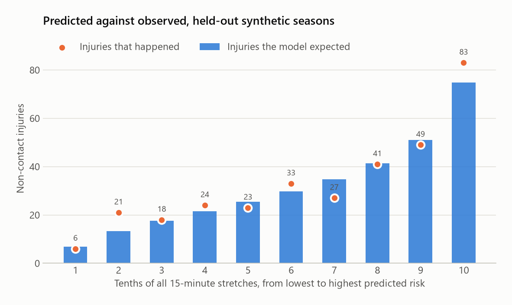

# live-injury-risk

Live, player-relative injury risk for football bench staff: during the match, each player's risk
for the rest of the game compared with his own normal, with the reason in plain words and the age
and quality of the data behind it.

This is the match-day half of a two-part system. The weekly half,
[football-injury-risk](https://github.com/ysmouhib/football-injury-risk), estimates each player's
risk for the coming week; that estimate is this tool's starting point at kick-off.

**What is built:** the full match-day pipeline, from tracking ingest and a 10-second feature
engine to a calibrated live hazard model, budgeted alert cards and a tablet app for the bench.
It runs offline on one machine, is replayable end to end with injected faults, is covered by 205
automated tests, and is judged by an evaluation plan fixed before the results were seen.

**Intended purpose.** Research and decision support for qualified staff. It shows risk; staff
decide.

<p align="center">
  
  <br>
  <sub>The bench screen at 34:05 of a replayed synthetic match: a Check card has just opened for #2 Centre back.</sub>
</p>

## The result in one minute

On synthetic seasons with a known effect planted in the running data, the tool found it: it
expected 316 injuries against 325 observed, and with 1.5 cards per team per match it put 8.6 %
of injuries into 2.3 % of playing time (3.8 times chance). All four tests fixed in advance
passed. The scores come from two held-out seasons: 30,991 fifteen-minute stretches of play and
325 non-contact injuries.

| Stretches ranked by the tool's risk | Injury rate per 15 minutes | Injuries expected by the tool / observed |
|---|---|---|
| Riskiest 10 % | 2.68 % | 74.9 / 83 |
| Middle 80 % | 0.95 % | 234.7 / 236 |
| Safest 10 % | 0.19 % | 6.8 / 6 |

<picture>
  <source media="(prefers-color-scheme: dark)" srcset="docs/img/calibration-dark.png">
  
</picture>

The spread between the riskiest and safest stretches mostly reflects how much risk variation
we planted, so read it as a check that the ranking is in the right order and the totals match,
not as a size to expect on real players. Full results: [docs/RESULTS.md](docs/RESULTS.md).

**Why synthetic.** No public dataset has both live player tracking and the minute of each
injury; clubs hold that data. So the test uses seasons we generated with a known effect planted
in the running data, and asks whether the tool finds it, gets the totals right and puts its
cards where the injuries are. It does, on every count. The next step is a club's own history
([docs/FOR_CLUBS.md](docs/FOR_CLUBS.md)).

## Proven so far, and next steps

**Proven on synthetic data:** the method recovers a planted effect, keeps its totals within 3 %
of what happens, and concentrates injuries in the stretches it flags, all under rules fixed in
advance. Because the test data come from the same kind of model the tool fits, this validates
the machinery; whether real players' running carries the same signal is what club data will
show, and real performance could be stronger or weaker. Injury rarity sets the ceiling for any
model: at real rates, at most about 1 card in 9 can be followed by an injury, which is why every
card asks only for a cheap action.

**Next steps:**

- **Validate on a club's history:** run the same four pre-registered tests on past seasons, then
  a shadow season before staff see any card.
- **Spread the cards across the match:** two fixes (D-029, D-030) moved the first card from 3:00
  to 10:00 or later in six replayed matches, and no team now spends both cards by 10:00 (8 of 12
  did before). All 24 cards still came before half-time, mostly on "short recovery between
  sprints", and the replays show why: that feature's first-half norms are too tight (spread of
  its player-relative scores 1.18 to 1.21 instead of about 1). Rebuilding them is the next fix.
- **Align the weekly input:** the weekly model predicts any time-loss injury (its public source
  cannot tell contact from non-contact) while this tool expects non-contact risk; a club's data
  calibrates the conversion.
- **Connect a live feed:** the tool reads recorded files and replays matches today; a live
  GPS-vest or stadium feed adapter is the remaining piece. A smaller display issue is listed in
  the [replay walkthrough](docs/REPLAY_WALKTHROUGH.md#known-issues-seen-in-this-replay).

## Reading the screen

One row per player, riskiest first: his pre-match band, how the live data moves his risk against
his own normal (×1.8 means 1.8 times his usual), his risk for the rest of the match, the main
reason, and how fresh the data is. A **Check** card asks the physio to watch the player at the
next stoppage; a **Discuss** card asks staff to talk through the options. Each team gets at most
two cards a match, and every card says "Not a prediction of injury; staff decide."

- [Bench guide](docs/BENCH_GUIDE.md): every column and card explained for coaches and staff.
- [A replayed match, moment by moment](docs/REPLAY_WALKTHROUGH.md): nine screens from one
  synthetic match, from the pre-match list to the post-match report.

## How it works

<picture>
  <source media="(prefers-color-scheme: dark)" srcset="docs/img/how_it_works-dark.png">
  
</picture>

The weekly model gives each player's risk for the match. During play, the running numbers
(high-speed metres, sprints, recovery between efforts) are compared with that player's own past
matches every 10 seconds, and every 60 seconds the tool updates his risk for the rest of the
match. Everything runs on one machine at the club; player data never leaves its network.

## Why it exists

Top leagues already put live technology on the bench. In 2023 LaLiga gave every club a tablet
for multi-angle video review, so staff can act faster after an injury
([announcement](https://www.laliga.com/en-GB/news/laliga-launches-video-review-system-a-sophisticated-system-that-will-help-the-technical-teams-on-the-bench-to-act-more-effectively-in-the-event-of-injury-in-real-time)),
and its [Mediacoach](https://newsletter.laliga.es/global-futbol/mediacoach-laliga-technology-minimise-injuries-football)
service gives staff live physical data for every player. Clubs also use
[Firstbeat Sports](https://www.firstbeat.com/en/blog/team-heart-rate-monitoring/) for live heart
rate and [Zone7](https://svexa.com/solutions/zone7-team-sports-injury-risk-and-load-planning/)
for daily injury-risk scores and load planning.

What this project adds is the comparison and the discipline around it. Live load is measured
against each player's own normal for that stage of the match rather than against fixed
thresholds, turned into a risk for the rest of the game with its range and the age of its data,
and passed to the bench through a strict card budget tied to agreed actions. The method, the
code and the pre-registered test results are all open.

## For developers

### Status

Version 0.1.0: every part is built and tested on synthetic data; nothing has been validated on
real club data yet.

| Part | Module | State |
|---|---|---|
| Maths core, Markov tools, contracts, wording | `livrisk.riskmath`, `livrisk.markov`, `livrisk.contracts`, `livrisk.app.wording` | done, tested |
| M1 configuration | `livrisk.config` | done |
| M2 synthetic data | `livrisk.synth` | done |
| M3 stream features | `livrisk.features.stream` | done |
| M4 player and team norms | `livrisk.features.norms` | done |
| M5 pre-match bridge | `livrisk.model.prematch` | done |
| M6 live hazard model | `livrisk.model.live_hazard` | done |
| M7 online risk engine | `livrisk.engine` | done |
| M8 alerts and operating point | `livrisk.alerts` | done |
| M9 replay and log store | `livrisk.replay`, `livrisk.storage` | done |
| M10 evaluation, Gate C, sensitivity | `livrisk.evaluation` | done |
| M11 bench app | `livrisk.app` | done |
| M12 ingest adapters | `livrisk.ingest` | done |
| M13 video identity | `livrisk.video` | done |
| M14 packaging and operations | `livrisk.cli` | done |

### Setup and usage

```bash
python -m venv .venv && source .venv/bin/activate   # Windows: .venv\Scripts\activate
pip install -e ".[dev]"                             # add ".[serve]" for WebSocket push
make check                                          # ruff, format, mypy (strict), tests

livrisk replay --synthetic --seed 211 --latency-s 30 --dropout-rate 0.05 --burst-s 30
livrisk evaluate --output report.md --card card.md  # reproduces the results above
```

Every command is deterministic for fixed seeds. Match-day operation, failure handling and shadow
mode: [docs/RUNBOOK.md](docs/RUNBOOK.md). The replay pages use player norms from ten earlier
synthetic matches (seeds 201 to 210) where `livrisk replay` uses one, so the command gives a
similar replay rather than the exact figures.

### Documentation

Specification: [overview](docs/00_OVERVIEW.md), [evidence](docs/01_EVIDENCE.md),
[maths](docs/02_MATH.md), [data contracts](docs/03_DATA_CONTRACTS.md),
[architecture](docs/04_ARCHITECTURE.md), [validation](docs/05_VALIDATION.md),
[bench interface](docs/06_UI_SPEC.md), [rules and ethics](docs/07_RULES_ETHICS.md),
[decisions](docs/DECISIONS.md). Operations: [runbook](docs/RUNBOOK.md),
[video input](docs/VIDEO_INPUT.md), [UI checklist](docs/UI_CHECKLIST.md).

No personal data is stored in this repository; see [data/README.md](data/README.md).
