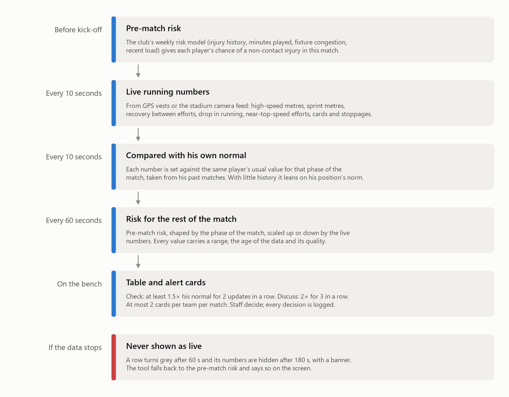

# Bench guide: reading the screen

[Back to the README](../README.md)

The screen is built for a three-second glance from the bench. The performance analyst or the
club doctor reads it and passes on what matters; the head coach gets a summary only.

| Column | What it tells you | Example |
|---|---|---|
| Player | Shirt number and position | `#4 Full back` |
| Pre-match | His risk band before kick-off, from the club's weekly risk model: Low, Watch or High | `Watch` |
| Now vs his normal | How the live data moves his risk compared with a match where he runs as he usually does at this stage. `×2.0 ▲` means twice his usual; `×0.7 ▼` means below it; a dash means no live figure | `×2.0 ▲` |
| Rest of match | His chance of a non-contact injury that keeps him out for at least 7 days, starting between now and the final whistle | `3.0 %` |
| Why | The main reason, in plain words | `Short recovery between sprints` |
| Data | How good and how fresh the data behind the row is: Good, Fair, Lost or Stale | `Good` |

**Why the percentages are small.** Injuries are rare. In elite men's football a player has about
a 3 % chance of any time-loss injury in a full match (21.1 injuries per 1,000 match hours,
Bengtsson et al. 2025), and a team has a muscle injury in a match about once every six matches.
A rest-of-match figure of 3.0 % is therefore high, and 0.5 % is ordinary.

**Alert cards.** Two levels, each tied to a cheap action agreed before the match. The figures
are updated every 60 seconds.

| Card | Opens when | Agreed action |
|---|---|---|
| Check | At least 1.5× his normal for 2 updates in a row, rest-of-match risk at least 0.4 %, data Good or Fair | The physio watches him at the next stoppage |
| Discuss | At least 2× his normal for 3 updates in a row | Staff talk through the options |

A card closes when the player is below 1.3× for 2 updates or leaves the pitch. Each team gets at
most **2 cards per match**, so that staff are not worn down by alerts; once both are used, no
further card opens in that match. Every card has four buttons (Acknowledge, Physio checked,
Discussed, Dismiss), and each press is logged with the match clock.

**Three things to keep in mind.**

1. **It shows risk; staff decide.** Every card carries the line "Not a prediction of injury;
   staff decide." The tool never suggests a substitution.
2. **Most cards will not be followed by an injury.** Injuries are so rare that even a very good
   model flags many more players than get injured. With two cards per team per match and real
   injury rates, at most about 1 card in 9 could be followed by a muscle injury, even if every
   injury were caught ([why](RESULTS.md#what-these-numbers-mean-for-a-real-club)). That is why a card asks
   for a look at the next stoppage and nothing more.
3. **A low number is not an all-clear.** Some injuries will always begin in players whose numbers
   look ordinary. How many, the tool cannot know until it is tested on a club's own data.

The head coach's view of the app shows only names, the card level and a one-line reason, with
no numbers.

## How it works during a match

<picture>
  <source media="(prefers-color-scheme: dark)" srcset="img/how_it_works-dark.png">
  
</picture>

A few details that matter on match day:

- **His own normal, not the squad's.** A winger who always sprints a lot is not flagged for
  sprinting a lot. Each number is compared with the same player's usual value at the same stage
  of past matches, with recent matches counting more.
- **The last 60 seconds are held back.** Every live number uses data that is at least 60 seconds
  old. The exact minute of an injury is only known to within about a minute, so this stops the
  injury itself (a player pulling up) from feeding the number that is meant to come before it.
- **The phase of the match counts.** Risk is not spread evenly over 90 minutes; the model learns
  how it changes from the start to the end of each half and in stoppage time.
- **Every figure has an age and a quality.** Data older than 60 seconds is greyed with its age;
  older than 180 seconds, the numbers are hidden and a banner says since when. A stale value is
  never shown as live.
- **It runs on one laptop or small server at the ground.** No internet connection, no cloud
  service, and player data never leaves the club's network. Every input, figure shown, alert
  and decision is logged for review after the match.
