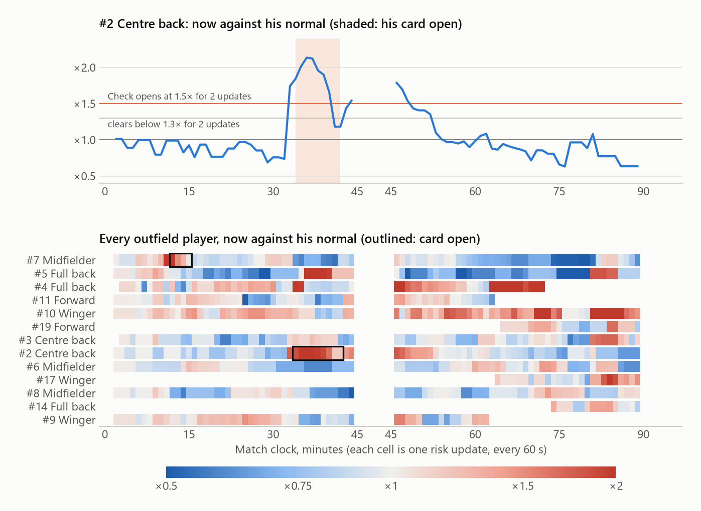
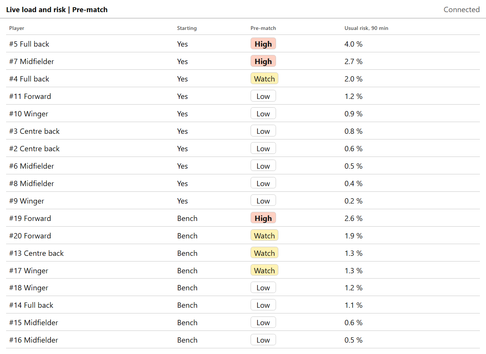
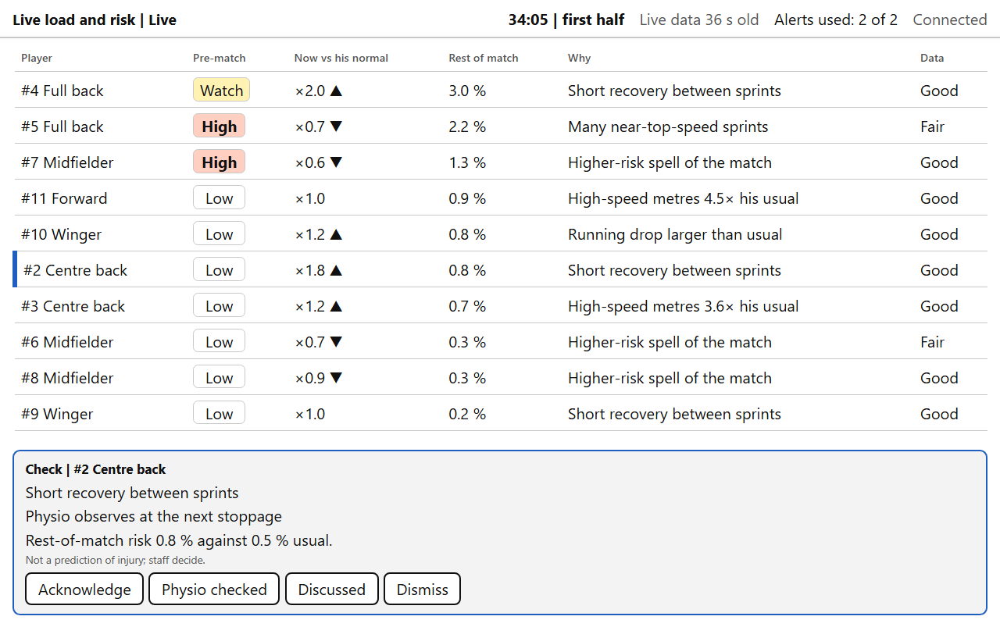
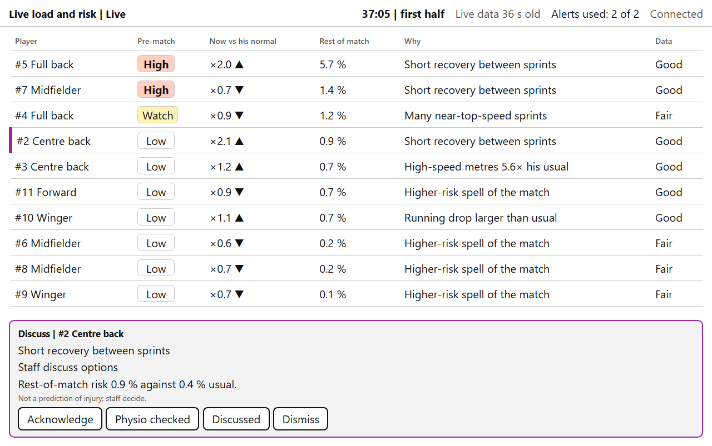
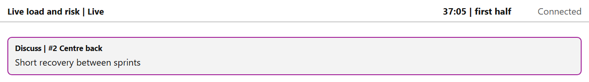
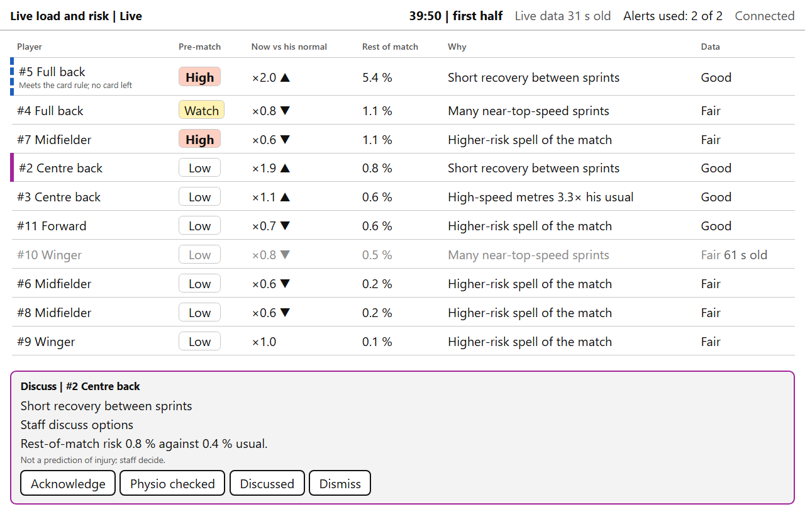
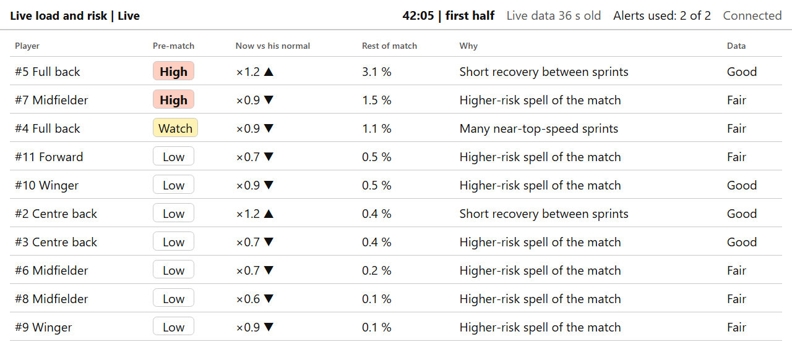
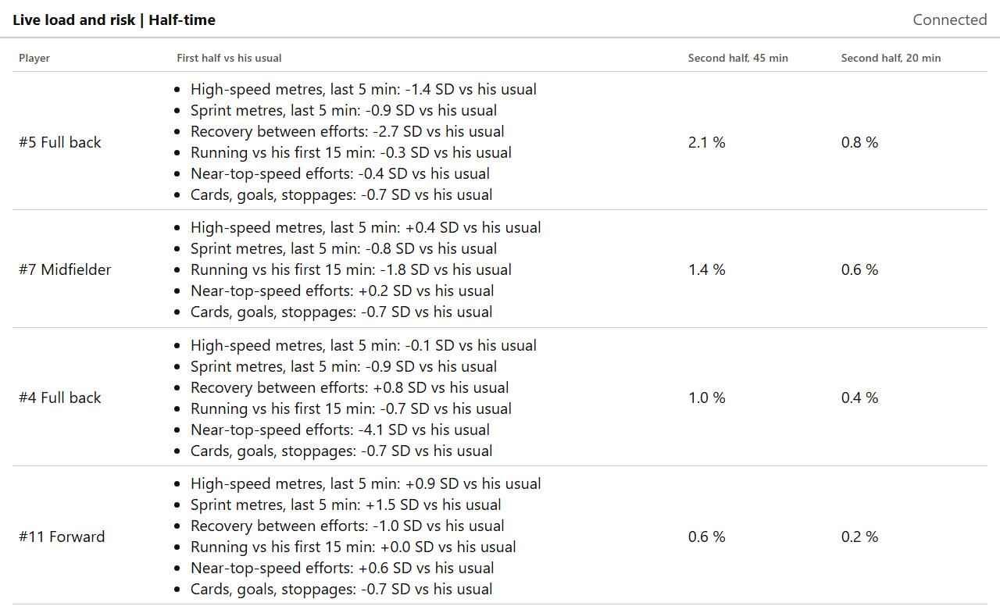
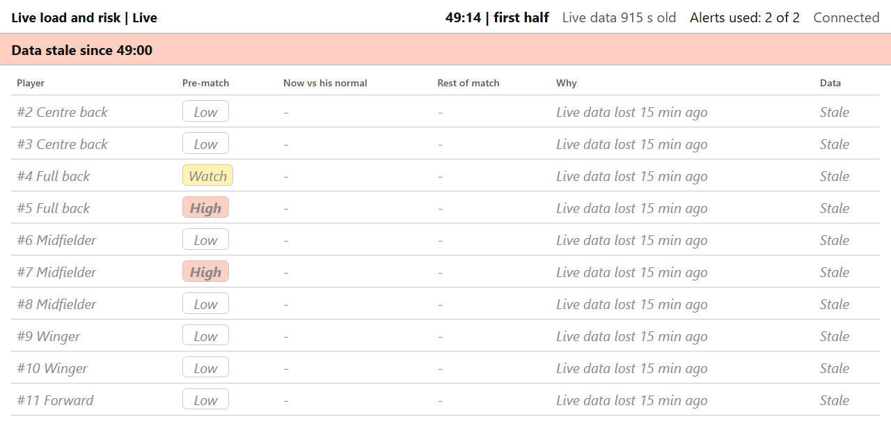
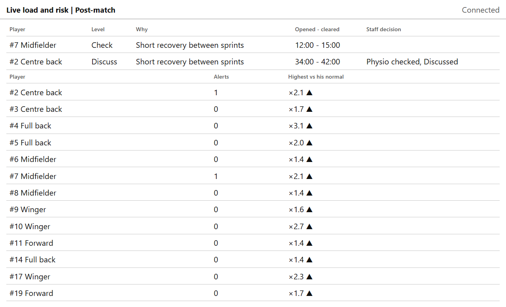

# A replayed match, moment by moment

[Back to the README](../README.md)

This is synthetic match 211, seen from the bench of team T1. All players are synthetic and are
known only by shirt number and position. The match was replayed through the live system as if
it were being played: every data point arrived 30 seconds late, 5 % of samples were lost, and
each player had one 30-second blackout per half (the stress scenario of
`docs/05_VALIDATION.md` §3). The screens below are what the bench app showed at each moment, and
the times and figures come from the replay log.

> In this synthetic match the injuries are drawn separately from the tracking data, so the
> screens show how the system behaves, not whether its cards were right. No player was injured
> in this match.

<picture>
  <source media="(prefers-color-scheme: dark)" srcset="img/match_timeline-dark.png">
  
</picture>

**Before kick-off.** The squad list with each player's pre-match band and usual risk over 90
minutes. #5 Full back starts as High (4.0 %), #2 Centre back as Low (0.6 %).

**12:00, the first card.** #7 Midfielder went from ×1.26 at 10:00 to ×2.11 at 11:00 and ×2.15
at 12:00 (5.8 % for the rest of the match, "Short recovery between sprints"), so a Check card
opened; it cleared at 15:00. 11:00 is the first update at which his recovery figure exists (a
10-minute window is used only once it is complete), so whether this jump is the player or the
first full window reading short is still an open question
(see [the limitations](../README.md#limitations)). It used one of the team's two cards.

**34:00, a Check card for #2 Centre back.** He had been below his normal (×0.74 to ×0.76 from
30:00 to 32:00). At 33:00 he jumped to ×1.74 and at 34:00 he was at ×1.84: two updates in a row
above 1.5, so a Check card opened, asking the physio to watch him at the next stoppage. His
rest-of-match risk was 0.8 % against 0.5 % usual. He started the match as Low: cards follow the
change against a player's own normal, not his pre-match band. #4 Full back is higher at this
moment (×2.0), but he had only just crossed the line, and a card needs two updates in a row.

**37:00, the card becomes Discuss.** ×2.02 at 35:00, ×2.14 at 36:00 and ×2.12 at 37:00: three
updates at 2× or more, so the card moved up to Discuss (staff talk through the options) without
using another card from the budget. The head coach's view shows only the card and its reason.

At the top of the same table, #5 Full back (pre-match High) was at ×2.0 with 5.7 % for the rest
of the match. He met the Check rule from 37:00, but both of the team's cards were already in use,
so no card opened for him: the first one had gone to #7 Midfielder at 12:00.

**39:50, old data is greyed.** #10 Winger's newest data was 61 seconds old (one of the injected
blackouts). His row is greyed and the Data column shows the age.

**42:00, the card clears.** ×1.18 at 41:00 and again at 42:00: two updates below 1.3, so the
card closed by itself.

**Half-time.** Each player's first half against his usual, and his risk for the second half if
he plays all 45 minutes or only 20. For #5 Full back: 2.1 % over 45 minutes, 0.8 % over 20.

**Second-half kick-off, no live data yet.** Fifteen seconds into the second half, nothing from
the second half had arrived (the data runs 30 seconds behind). Rather than carry first-half
figures into the second half, the screen hides every figure and says when the data stopped.

**63:00, no card left.** #4 Full back rose to ×3.09 his normal at 63:00 (2.22 % for the rest of
the match) and stayed at ×2.5 or more until 68:00. Both cards had been used in the first half, so no
card opened; he stayed at the top of the table.

**After the match.** Both cards with their times and the staff decisions (entered by hand during
the replay), and each player's highest figure against his normal.

## Known issues seen in this replay

- **Cards still cluster in the first half.** Across six replayed matches (seeds 211 to 216), all
  24 cards opened before half-time, the earliest at 10:00, most on "short recovery between
  sprints" soon after that figure first becomes available. Before D-029 and D-030 the first card
  came as early as 3:00, and 8 of the 12 teams had spent both cards by 10:00.
- **"N× his usual" reads high.** The Why column compares the current value with a typical value
  on a log scale, so it can read high for a player at his normal overall ("High-speed metres
  4.5× his usual" at ×1.0 in the 34:05 screen).
- **No marker after the budget is used.** Players who qualify once both cards are used should
  get a subtle marker in the table (docs/06_UI_SPEC.md §3); the alert logic computes it but the
  screen does not show it yet (#5 Full back at 37:00, #4 Full back at 63:00).
- **Header clock at the second-half kick-off.** Until the first second-half data arrives, the
  header clock counts on from the last first-half update ("49:14, first half" above).
